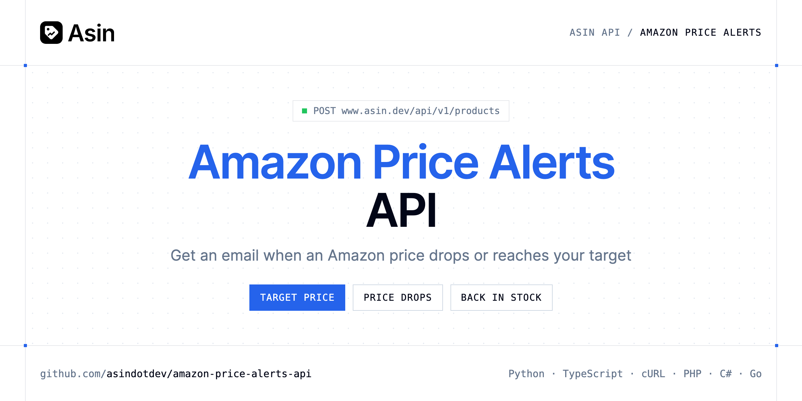

<p align="center">
  <a href="https://www.asin.dev"></a>
</p>

# Amazon Price Alerts API

[](https://www.asin.dev/signup) [](https://www.asin.dev/docs) [](LICENSE)

The **Asin Amazon Price Alerts API** adds a product with a target price and changes its alerts later. Asin emails the account owner when the price drops, reaches the target or the product is back in stock.

- **Track a Product with a Target Price** — Adds an ASIN, an Amazon link or a short link (amzn.to, a.co…) to your watchlist.
- **Change Alerts** — Target price, drop alerts, check interval, or pause.

Use it to add price alerts to your own product, for buying decisions or to watch restocks.

| Endpoint | Request | Cost |
|---|---|---|
| [Track a Product with a Target Price](#track-a-product-with-a-target-price) | `POST /products` | 1 credit per price check |
| [Change Alerts](#change-alerts) | `PATCH /products/{id}` | No credit |

## Table of contents

- [How it works](#how-it-works)
- [Track a Product with a Target Price](#track-a-product-with-a-target-price)
- [Change Alerts](#change-alerts)
- [Code examples in other languages](#code-examples-in-other-languages)
- [Use cases](#use-cases)
- [Why Asin?](#why-asin)
- [FAQ](#faq)
- [Official SDKs](#official-sdks)
- [Related repositories](#related-repositories)
- [Support](#support)

## How it works

1. **[Create an Asin account](https://www.asin.dev/signup)** and copy your API key from [your account](https://www.asin.dev/app#api).
2. **Call `https://www.asin.dev/api/v1`** with the header `Authorization: Bearer YOUR_API_KEY`.
3. **Use the result** in your app, or let Asin email you when a price moves.

```bash
export ASIN_API_KEY="your-api-key"
pip install requests        # Python
# TypeScript: Node.js 18+ (native fetch), run with `npx tsx file.ts`
```

## Track a Product with a Target Price

Adds an ASIN, an Amazon link or a short link (amzn.to, a.co…) to your watchlist. The first check runs in the background within seconds (checking is true until then): poll GET /products/{id}, or send wait: true to get the answer once it's done (up to 45 seconds). Each price check of a tracked product costs 1 credit; a product checked daily uses about 30 credits a month. Without credits the product is added and its first check waits. What Amazon answers shows on the product (last_error), never as an error here. Adding a product you already track returns it unchanged, with status 200.

`POST https://www.asin.dev/api/v1/products` · **1 credit per price check** · [API reference](https://www.asin.dev/docs)

### Request parameters

| Parameter | In | Type | Required | Description |
|---|---|---|---|---|
| `product` | body | string | ✅ | ASIN (B09DFCB66S) or Amazon product link |
| `marketplace` | body | string (`com`, `co.uk`, `de`, `fr`, `it`, `es`) | — | Amazon store, e.g. com for amazon.com. A product link sets it on its own. |
| `target_price` | body | number | — | Email the owner when the price goes at or below this amount. null removes it. |
| `interval_minutes` | body | integer (`5`, `30`, `60`, `360`, `720`, `1440`) | — | Minutes between two checks (1440 = daily). Checks faster than daily need a plan or a credit pack: every 60 minutes with a pack or Starter, 30 with Pro, 5 with Business. |
| `wait` | body | boolean | — | Answer once the first check is done (up to 45 seconds) |

### Python example

```python
import os

import requests

API_KEY = os.environ["ASIN_API_KEY"]
HEADERS = {"Authorization": f"Bearer {API_KEY}"}

response = requests.post(
    "https://www.asin.dev/api/v1/products",
    headers=HEADERS,
    json={'product': 'B09DFCB66S', 'marketplace': 'com', 'target_price': 70},
    timeout=120,
)
response.raise_for_status()

data = response.json()
print(data)
```

### TypeScript example

```typescript
type TrackAProductWithATargetPrice = {
  product_id?: string;
  asin?: string;
  marketplace?: string;
  url?: string;
  title?: string;
  image?: string;
  brand?: string;
  currency?: string;
  price?: number;
  first_price?: number;
  lowest_price?: number;
  highest_price?: number;
  in_stock?: boolean;
  stock?: string;
  coupon?: string;
  seller?: string;
  best_sellers_rank?: string;
  target_price?: number;
  alert_on_drop?: boolean;
  interval_minutes?: number;
  status?: string;
  last_error?: string;
  found_on?: string[];
  checking?: boolean;
  last_checked_at?: string;
  [key: string]: unknown;
};

const headers = { Authorization: `Bearer ${process.env.ASIN_API_KEY!}`, "Content-Type": "application/json" };

const response = await fetch("https://www.asin.dev/api/v1/products", {
  method: "POST",
  headers,
  body: JSON.stringify({
  "product": "B09DFCB66S",
  "marketplace": "com",
  "target_price": 70
}),
});
if (!response.ok) throw new Error(`HTTP ${response.status}: ${await response.text()}`);

const data = (await response.json()) as TrackAProductWithATargetPrice;
console.log(data);
```

### Output example

Example response from the API reference, abridged.

```json
{
  "product_id": "8f0b3c7e-2a4d-4e51-9c1a-6d2f1b9e7a30",
  "asin": "B09DFCB66S",
  "marketplace": "com",
  "url": "https://www.amazon.com/dp/B09DFCB66S",
  "title": "Wireless Earbuds, Bluetooth 5.3, Noise Cancelling",
  "image": "https://m.media-amazon.com/images/I/…jpg",
  "brand": "Example Audio",
  "currency": "USD",
  "price": 79.99,
  "first_price": 99.99,
  "lowest_price": 74.5,
  "highest_price": 99.99,
  "in_stock": true,
  "stock": "In Stock",
  "coupon": null,
  "seller": "example",
  "best_sellers_rank": "#152 in Electronics",
  "target_price": 70,
  "alert_on_drop": true,
  "interval_minutes": 1440,
  "status": "active",
  "last_error": null,
  "found_on": [],
  "checking": false,
  "last_checked_at": "2026-11-03T08:00:12.441Z"
}
```

### Response fields

| Field | Type | Description |
|---|---|---|
| `product_id` | string | Id of this watchlist entry |
| `asin` | string | Amazon's 10-character product code |
| `marketplace` | string | Amazon store |
| `url` | string | Product page on Amazon |
| `title` | string | null until the first check |
| `image` | string | Main product image |
| `brand` | string | Brand shown by Amazon |
| `currency` | string | ISO code, e.g. USD, EUR, JPY |
| `price` | number | Latest price; null when there is no offer |
| `first_price` | number | Price at the first check |
| `lowest_price` | number | Lowest price seen |
| `highest_price` | number | Highest price seen |
| `in_stock` | boolean | null until the first check |
| `stock` | string | Amazon's availability text |
| `coupon` | string | Coupon shown on the page, if any |
| `seller` | string | Seller of the offer shown (Buy Box) |
| `best_sellers_rank` | string | Main Best Sellers Rank |
| `target_price` | number | Alert threshold |
| `alert_on_drop` | boolean | Email when the price drops or the product is back in stock |
| `interval_minutes` | integer | Minutes between two checks |
| `status` | string | Paused products aren't checked |
| `last_error` | string | Why the last check didn't go through, if it didn't |
| `found_on` | string[] | When last_error is product_not_found: marketplaces where the ASIN exists |
| `checking` | boolean | A check is due or running; poll until it's false |
| `last_checked_at` | string | When the last check ran |

## Change Alerts

Target price, drop alerts, check interval, or pause. Send only what changes.

`PATCH https://www.asin.dev/api/v1/products/{id}` · **No credit** · [API reference](https://www.asin.dev/docs)

### Request parameters

| Parameter | In | Type | Required | Description |
|---|---|---|---|---|
| `id` | path | string | ✅ | product_id returned when the product was added |
| `target_price` | body | number | — | Email the owner when the price goes at or below this amount. null removes it. |
| `interval_minutes` | body | integer (`5`, `30`, `60`, `360`, `720`, `1440`) | — | Minutes between two checks (1440 = daily). Checks faster than daily need a plan or a credit pack: every 60 minutes with a pack or Starter, 30 with Pro, 5 with Business. |
| `alert_on_drop` | body | boolean | — | Email when the price drops or the product is back in stock |
| `paused` | body | boolean | — | Stop checking (and charging) for now; false resumes |

### Python example

```python
import os

import requests

API_KEY = os.environ["ASIN_API_KEY"]
HEADERS = {"Authorization": f"Bearer {API_KEY}"}

response = requests.patch(
    "https://www.asin.dev/api/v1/products/8f0b3c7e-2a4d-4e51-9c1a-6d2f1b9e7a30",
    headers=HEADERS,
    json={'target_price': 65, 'alert_on_drop': True},
    timeout=120,
)
response.raise_for_status()

data = response.json()
print(data)
```

### TypeScript example

```typescript
type ChangeAlerts = {
  product_id?: string;
  asin?: string;
  marketplace?: string;
  url?: string;
  title?: string;
  image?: string;
  brand?: string;
  currency?: string;
  price?: number;
  first_price?: number;
  lowest_price?: number;
  highest_price?: number;
  in_stock?: boolean;
  stock?: string;
  coupon?: string;
  seller?: string;
  best_sellers_rank?: string;
  target_price?: number;
  alert_on_drop?: boolean;
  interval_minutes?: number;
  status?: string;
  last_error?: string;
  found_on?: string[];
  checking?: boolean;
  last_checked_at?: string;
  [key: string]: unknown;
};

const headers = { Authorization: `Bearer ${process.env.ASIN_API_KEY!}`, "Content-Type": "application/json" };

const response = await fetch("https://www.asin.dev/api/v1/products/8f0b3c7e-2a4d-4e51-9c1a-6d2f1b9e7a30", {
  method: "PATCH",
  headers,
  body: JSON.stringify({
  "target_price": 65,
  "alert_on_drop": true
}),
});
if (!response.ok) throw new Error(`HTTP ${response.status}: ${await response.text()}`);

const data = (await response.json()) as ChangeAlerts;
console.log(data);
```

### Output example

Example response from the API reference, abridged.

```json
{
  "product_id": "8f0b3c7e-2a4d-4e51-9c1a-6d2f1b9e7a30",
  "asin": "B09DFCB66S",
  "marketplace": "com",
  "url": "https://www.amazon.com/dp/B09DFCB66S",
  "title": "Wireless Earbuds, Bluetooth 5.3, Noise Cancelling",
  "image": "https://m.media-amazon.com/images/I/…jpg",
  "brand": "Example Audio",
  "currency": "USD",
  "price": 79.99,
  "first_price": 99.99,
  "lowest_price": 74.5,
  "highest_price": 99.99,
  "in_stock": true,
  "stock": "In Stock",
  "coupon": null,
  "seller": "example",
  "best_sellers_rank": "#152 in Electronics",
  "target_price": 70,
  "alert_on_drop": true,
  "interval_minutes": 1440,
  "status": "active",
  "last_error": null,
  "found_on": [],
  "checking": false,
  "last_checked_at": "2026-11-03T08:00:12.441Z"
}
```

### Response fields

| Field | Type | Description |
|---|---|---|
| `product_id` | string | Id of this watchlist entry |
| `asin` | string | Amazon's 10-character product code |
| `marketplace` | string | Amazon store |
| `url` | string | Product page on Amazon |
| `title` | string | null until the first check |
| `image` | string | Main product image |
| `brand` | string | Brand shown by Amazon |
| `currency` | string | ISO code, e.g. USD, EUR, JPY |
| `price` | number | Latest price; null when there is no offer |
| `first_price` | number | Price at the first check |
| `lowest_price` | number | Lowest price seen |
| `highest_price` | number | Highest price seen |
| `in_stock` | boolean | null until the first check |
| `stock` | string | Amazon's availability text |
| `coupon` | string | Coupon shown on the page, if any |
| `seller` | string | Seller of the offer shown (Buy Box) |
| `best_sellers_rank` | string | Main Best Sellers Rank |
| `target_price` | number | Alert threshold |
| `alert_on_drop` | boolean | Email when the price drops or the product is back in stock |
| `interval_minutes` | integer | Minutes between two checks |
| `status` | string | Paused products aren't checked |
| `last_error` | string | Why the last check didn't go through, if it didn't |
| `found_on` | string[] | When last_error is product_not_found: marketplaces where the ASIN exists |
| `checking` | boolean | A check is due or running; poll until it's false |
| `last_checked_at` | string | When the last check ran |

## Code examples in other languages

Ready-to-run examples live in [`examples/`](examples); each reads your key from `ASIN_API_KEY`.

| Language | `create-alert` | `update-alert` |
|---|---|---|
| cURL (Bash) | [create_alert.sh](examples/curl/create_alert.sh) | [update_alert.sh](examples/curl/update_alert.sh) |
| PHP | [create_alert.php](examples/php/create_alert.php) | [update_alert.php](examples/php/update_alert.php) |
| C# | [CreateAlert.cs](examples/csharp/CreateAlert.cs) | [UpdateAlert.cs](examples/csharp/UpdateAlert.cs) |
| Go | [create_alert.go](examples/go/create_alert.go) | [update_alert.go](examples/go/update_alert.go) |
| Java | [CreateAlertExample.java](examples/java/CreateAlertExample.java) | [UpdateAlertExample.java](examples/java/UpdateAlertExample.java) |
| Ruby | [create_alert.rb](examples/ruby/create_alert.rb) | [update_alert.rb](examples/ruby/update_alert.rb) |
| Node.js | [create_alert.mjs](examples/nodejs/create_alert.mjs) | [update_alert.mjs](examples/nodejs/update_alert.mjs) |

## Use cases

- **Target prices** — Get an email once a product reaches the price you want to pay.
- **Drop alerts** — Hear about every price drop with `alert_on_drop`.
- **Restocks** — Know when a product is back in stock.

## Why Asin?

- **A watchlist that runs on its own** — each product is checked on schedule, from every 5 minutes to every 24 hours depending on the plan.
- **Price history for any ASIN** — read every price Asin has seen, free and without tracking the product.
- **Alerts by email** — price drops, target prices and products back in stock.
- **Pay for what you check** — each price check costs 1 credit (about 30 credits a month for a product checked daily) and failed checks are refunded. Free for 50 products.
- **Use it your way** — the same API key works with the REST API, the MCP server and the Chrome extension, with official SDKs in 7 languages.
- **Copy-paste examples** — Python and TypeScript in each README, 7 more languages in `examples/`.

## FAQ

### How do I authenticate?

[Create an Asin account](https://www.asin.dev/signup), copy your API key from [your account](https://www.asin.dev/app#api) and send it as `Authorization: Bearer YOUR_API_KEY` with every request to `https://www.asin.dev/api/v1`. Keys start with `asin_`.

### How much does it cost?

`POST /products`: 1 credit per price check, `PATCH /products/{id}`: No credit. Asin is free for 50 products; a product checked daily uses about 30 credits a month and failed checks are refunded. See [Asin pricing](https://www.asin.dev/pricing).

### Who receives the alerts?

The owner of the account, by email.

### How do I remove a target price?

Send `"target_price": null` with `PATCH /products/{id}`.

### Which Amazon stores are supported?

11 marketplaces, set with `marketplace`: `com` (default), `co.uk`, `de`, `fr`, `it`, `es`, `ca`, `co.jp`, `com.br`, `com.mx` and `in`.

### Is there an official SDK?

Yes: [Python](https://github.com/asindotdev/asin-python), [Node.js & TypeScript](https://github.com/asindotdev/asin-node), [Go](https://github.com/asindotdev/asin-go), [PHP](https://github.com/asindotdev/asin-php), [Ruby](https://github.com/asindotdev/asin-ruby), [Java](https://github.com/asindotdev/asin-java) and [.NET](https://github.com/asindotdev/asin-dotnet), plus a [CLI](https://github.com/asindotdev/asin-cli) and an [MCP server](https://github.com/asindotdev/asin-mcp). The examples here use plain HTTP so you can see the raw API.

### Which languages are supported?

Any language that can make an HTTP request. This README shows Python and TypeScript; the [`examples/`](examples) folder contains cURL, PHP, C#, Go, Java, Ruby and Node.js.

## Official SDKs

Use Asin from your own language with a typed client:

| SDK | Package | Install |
| --- | --- | --- |
| Node.js | [`@asindev/sdk`](https://www.npmjs.com/package/@asindev/sdk) | `npm install @asindev/sdk` |
| Python | [`asindotdev`](https://pypi.org/project/asindotdev/) | `pip install asindotdev` |
| Go | [`asin-go`](https://pkg.go.dev/github.com/asindotdev/asin-go) | `go get github.com/asindotdev/asin-go` |
| .NET | [`Asin`](https://www.nuget.org/packages/Asin) | `dotnet add package Asin` |
| Ruby | [`asindotdev`](https://rubygems.org/gems/asindotdev) | `gem install asindotdev` |
| PHP | [`asindotdev/sdk`](https://packagist.org/packages/asindotdev/sdk) | `composer require asindotdev/sdk` |
| Java | [`asin-java`](https://github.com/asindotdev/asin-java) | build from source, see its README |
| CLI | [`@asindev/cli`](https://www.npmjs.com/package/@asindev/cli) | `npm install -g @asindev/cli` |
| MCP server | [`@asindev/mcp`](https://www.npmjs.com/package/@asindev/mcp) | `npx -y @asindev/mcp` |

## Related repositories

- [Amazon Price Tracker API](https://github.com/asindotdev/amazon-price-tracker-api)
- [Amazon Price History API](https://github.com/asindotdev/amazon-price-history-api)
- [Amazon Offers API](https://github.com/asindotdev/amazon-offers-api)
- [Amazon Search API](https://github.com/asindotdev/amazon-search-api)
- [All Asin repositories](https://github.com/asindotdev)

## Support

- 📚 Read the [API reference](https://www.asin.dev/docs).
- ✉️ Write to [contact@asin.dev](mailto:contact@asin.dev).
- 🔑 [Get your API key](https://www.asin.dev/signup).

---

<p align="center">
  <a href="https://www.asin.dev">
    <picture>
      <source media="(prefers-color-scheme: dark)" srcset="images/logo-dark.svg">
      
    </picture>
  </a>
  <br>
  <sub>Built by <a href="https://www.asin.dev">Asin</a>. Examples are released under the MIT license.</sub>
</p>
